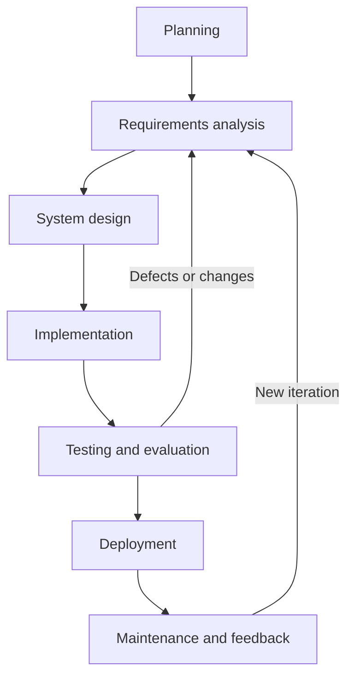

# System development methodology

## Chapter 3 draft

The NLP-Based Academic Services and Records Assistant for Rizal Technological University – Pasig Branch was developed through an iterative software development approach. The repository shows successive implementation, integration and corrective changes to the academic services portal. Rather than treating every phase as a one-time activity, development revisited requirements, implementation and testing as new findings emerged. The observed workflow is consistent with Agile principles of incremental delivery and adaptation; formal Scrum ceremonies are not claimed.

### Planning
The project addresses access to academic document services, appointment scheduling and communication between students and academic staff. The proposed scope includes student and staff portals, document request tracking, scheduling, notifications, announcements, support and an academic assistant. The team should attach its original proposal, approved objectives, scope, resource plan and Gantt chart to establish planning evidence. These were not independently verified in the repository review.

### Requirements analysis
The functional requirements were derived for this retrospective register from implemented workflows and documented change requests. These include account authentication, role separation, document requests, appointment integrity, processing and release, announcements, notifications, support ticket lifecycle and natural-language assistance. Nonfunctional requirements cover access control, integrity, privacy, usability and session management. Original stakeholder requirements, interviews or approvals must be attached if available; their completion is not inferred from code.

### System design
The portal uses browser-based HTML, CSS and JavaScript with Supabase for authentication, PostgreSQL persistence and Realtime synchronization. Student and staff interfaces are separated by role and route. Database-backed services adapt the existing interface to server-side persistence. The design includes transactional request/appointment creation, booking collision prevention, lifecycle guards and database authorization. The NLP assistant uses deterministic text normalization, token and phrase matching, bounded edit distance, intent classification and document entity extraction to select portal guidance and routes. It is not a trained generative model. A verified physical ERD, schema export and data dictionary should accompany this design.

### Development
The frontend was restored and connected to Supabase Auth in PRs #1–2. Requests and appointment persistence followed in #4, then checklist persistence and error handling in #5–6. Subsequent work improved scheduling, releases, announcement integration, Realtime notifications, support tickets, role identity and inactivity controls. PR #22 added the rule-based NLP assistant. GitHub branches, commits and merges provide a versioned implementation record. See the dated history.

### Testing
The repository includes deterministic smoke-test scripts and manual acceptance procedures for request workflows, reporting, announcements, support, accounts and NLP. Tests specify expected behavior and data-quality safeguards. The existence of tests does not establish execution or passing results; retain terminal logs, browser screenshots, tester names and dates for each run. A live report defect identified on 24 November demonstrates why regression testing must include database-backed records rather than only earlier browser-local fixtures.

### Deployment
The project uses GitHub Pages for the frontend and Supabase for the backend. Integration documentation prescribes SQL deployment order, authenticated testing and browser cache refresh. A merged pull request is evidence of version integration, not independent evidence of the deployed revision. Record deployment URL, actual commit, SQL migration version and smoke-test outcome for each release.

### Maintenance
Maintenance activities include bug correction, permission review, notification behavior improvements, session protection and documentation alignment. The announcement change and subsequent revert in PRs #10–11 demonstrate reversible change control. The report-validation defect and database cleanup review remain open work unless later evidence establishes resolution. Future changes should be reviewed, tested, merged and documented in a defect register.

## Design evidence

| Component | Repository evidence |
|---|---|
| Database integration | [Request and appointment integration](../../SUPABASE-REQUESTS-APPOINTMENTS.md) |
| Realtime | [Realtime architecture and QA](../../SUPABASE-REALTIME-NOTIFICATIONS.md) |
| Support | [Support integration and acceptance criteria](../../SUPABASE-SUPPORT-TICKETS.md) |
| Session security | [Inactivity policy](../../SESSION-TIMEOUT.md) |
| NLP | [Assistant architecture](../../NLP-ASSISTANT.md) |
| Reports | [Phase G specification](../../PHASE-G.md) |

**Academic validation:** The researchers must review the draft and replace retrospective planning/requirements descriptions with their actual records before submission.
